### Hi, I'm Tania

Developer for 13 years, most of them on React and React Native apps used by millions of people. Right now I'm a Senior Mobile Engineer (contract) at The Ready Collective, working across the React Native app, the web app and the Node.js backend.

My day job is in private repos. These are my side projects:

| | Project | What it does | Built with |
| :-: | --- | --- | --- |
| 🎯 | [job-hunter](https://github.com/altany/job-hunter) | An MCP server that turns Claude into a job search assistant | Node.js, MCP, Google Sheets |
| 🚗 | [Pesto](https://github.com/altany/mila) | Greek voice commands for Android Auto | Kotlin, Android Auto |
| 🎙️ | [voice-planner](https://github.com/altany/voice-planner) | A voice to-do list that runs on a Raspberry Pi | Python, OpenAI, Raspberry Pi |
| 🐕 | [marios-helper](https://github.com/altany/marios-helper) | Medication reminders for my dog, Mario | React Native, Expo |
| 🌐 | [tany4](https://github.com/altany/tany4) | My website, blog and CV | Next.js, Vercel |

### Latest posts

<!-- POSTS:START -->
- [What I built after Kent C. Dodds's webinar](https://tany4.com/blog/posts/what-i-built-after-the-kent-c-dodds-post) · 17 Oct 2026
- [Greek voice commands for Android Auto](https://tany4.com/blog/posts/greek-voice-commands-for-android-auto) · 11 Oct 2026
- [What I'm taking from Kent C. Dodds's agent setup, and what I'm not](https://tany4.com/blog/posts/what-i-take-from-kent-c-dodds-agent-setup) · 3 Oct 2026
- [Running AI coding sessions in parallel](https://tany4.com/blog/posts/running-ai-coding-sessions-in-parallel) · 1 Oct 2026
<!-- POSTS:END -->

### Stack

### Elsewhere

